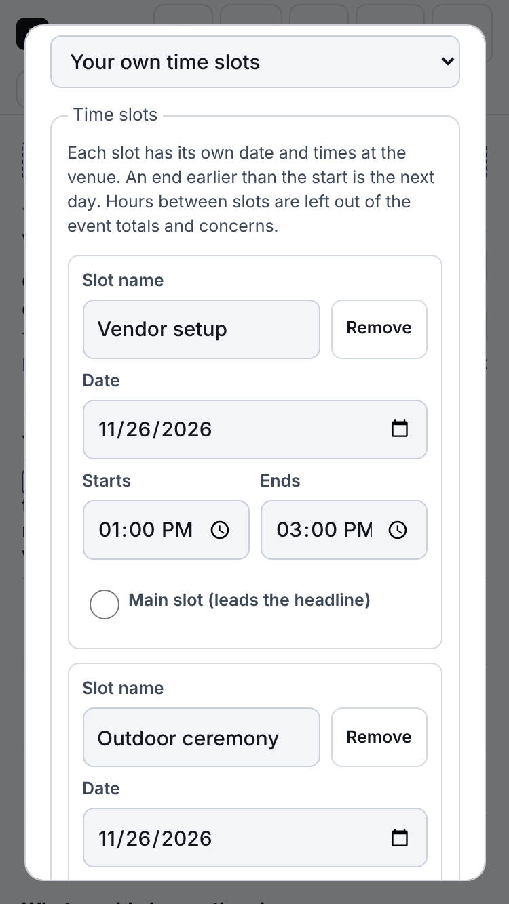
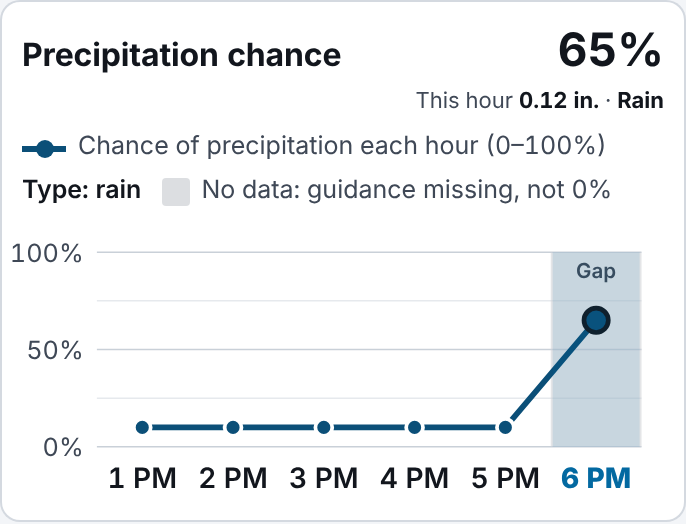

# Event Manager: planner-defined schedules (beta)

Events without gates (weddings, receptions, festivals) set their own time slots. New events start with one
editable **Event** window; planners add, rename and remove slots, each with its own date, start and end in the
venue's time zone. The stadium schedule (Setup, Gates, Event, Teardown from the venue's defaults) is an optional
template. Forecast calculations and thresholds are unchanged.

 

## Data model

```
event.slots = [{ id, name, start, end, main?, fold? }]   // venue-local "YYYY-MM-DDTHH:MM"; end may be the next day
event.times = { start, end }                             // the slots' outer start and end, kept beside them
```

* `Core.event.windows(ev)` returns one window per slot, in time order, labelled with the slot's name. The main slot
  takes the key `event` (everything that leads with the main part keeps working); other slots keep their own id.
  `all` spans the first start to the last end, and `all.spans` lists the hours the event actually uses (the union of
  its slots; one span for the fixed parts).
* An event **without** `slots` is read exactly as before (`times: {setup, gates, start, end, teardown}`). Nothing stored
  or shared is rewritten. In the editor such an event opens on the stadium template; if its parts are saved unchanged,
  it is saved as fixed parts again (`Core.event.legacyTimes`). A schedule that is exactly Setup / Gates / Event /
  Teardown back to back, or one window named Event, is always stored as fixed parts.
* Validation: every slot needs a name and a start and end, ends after it starts, no time skipped by a clock change,
  at most 24 slots and 7 days in all. Gaps are allowed. Overlapping slots and repeated names are warnings in the
  editor, not errors.

## Main slot

The slot that leads the headline ("Rain likely through the 4 PM Outdoor ceremony"):

1. the slot marked **Main slot** in the editor (the Wedding template marks the Outdoor ceremony);
2. otherwise the slot named "Event";
3. otherwise the longest slot that isn't setup, gates, doors, load-in or teardown work;
4. otherwise the first slot.

When a concern doesn't touch the main slot, the headline names the first slot it does touch ("Plan for rain during
the Reception, from 7 PM").

## Gaps between slots

* An hour is **between slots** when neither reading of its hourly value touches a slot: the hour starting at its
  label (how the hourly grid and charts show it) and the hour ending at it (how accumulated amounts work, and how
  each slot's own rating reads them, `Core.event.locate`). In other words `[label - 1 h, label + 1 h)` lies wholly in a
  gap (`Core.event.inSpans`).
* Hours between slots stay in the hourly grid and the hourly charts with their values, shaded and labelled
  "Between slots" / "Gap". They are left out of the concern hours, hazard timing (each source's first hour), the
  attention tracks, At a glance and every total.
* Totals over discontiguous slots are the same blend call (`C.blend.windowRow`) over the remaining hours, so a total is
  the sum of those hours' amounts. Per-hour values and every threshold are unchanged; each slot is still rated on its
  own hours exactly as the fixed parts are.
* Rain timing across slots reads each source span by span (the same `ModelTrends.timing` call) and takes its first
  wet span.
* "Why this is flagged" says which hours the totals cover: "Totals cover your slots: 1–3 PM, 4–4:30 PM, 7–10 PM;
  hours wholly between them are not counted." The printout's summary says "Rain over your slots (…)".
* Guidance is hourly and an hour can't be split, so a gap shorter than two hours (the wedding's 3–4 PM and
  4:30–5 PM) holds no whole hour: its hours are shared with the neighbouring slots and counted with them, the same
  way a 30-minute Gates part is read today. A longer break (4:30–7 PM before a 7 PM reception) leaves the 6 PM hour out.

## Share links and backups

* Old links (`t: {setup, gates, start, end, teardown}`) open as before and produce the same link again.
* New links add `s: [[name, start, end, flags?], …]` (flags: `{m:1}` main slot, `{s:1}`/`{e:1}` second occurrence of
  a repeated fall-back time) and keep `t: {start, end}` as the outer window.
* A page from before slots ignores `s` and opens the link as one Event window over the same outer hours: the
  briefing then covers the gaps too and names no slots. Nothing fails.
* Workspace backups keep `slots` field by field (`cleanSlot`); a file from before slots restores unchanged.
* Calendar imports: an event at a known venue gets that venue's schedule as before; any other import is one Event
  window. An imported event the planner split into slots keeps its slots when the calendar moves it (each slot
  keeps its offset from the calendar start).

## Multi-day view (sketch, not built)


A weekend festival (Fri 5–11 PM, Sat 10 AM–11 PM, Sun 10 AM–6 PM) is three slots today. The briefing already skips
the overnight downtime (hazard timing and totals follow the operating windows) and says "Sunday pending" while the
guidance does not reach it. The follow-up would add:

* **Day picker**: one button per day with its hours and a one-line outlook ("No concern", "Rain 2–4 PM",
  "Missing guidance" when a later slot is beyond the models' reach).
* **Per-day briefing**: the lead, callouts, At a glance and hour by hour for the selected day's slots only.
* **Two-page printout for the selected day**: the same handout and hour table, titled with the day.
* **Official alerts** are still checked for the venue, for the whole event.

Built today, for reference: rain in an hour between slots stays visible in the hourly chart, shaded and labelled,
and is left out of the totals and concerns.


