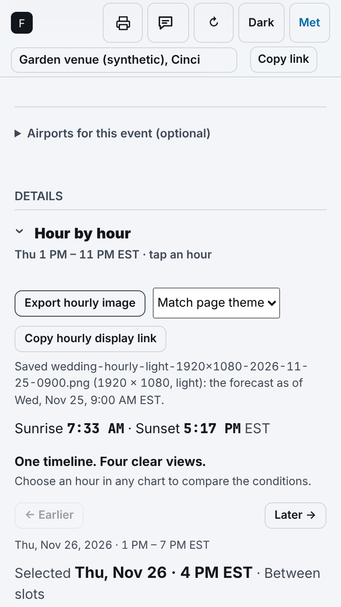
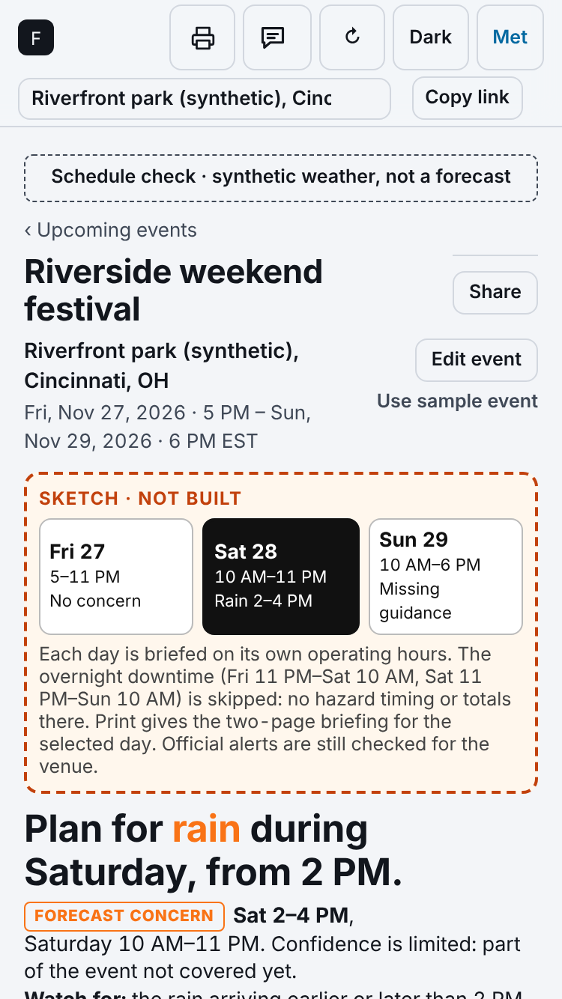
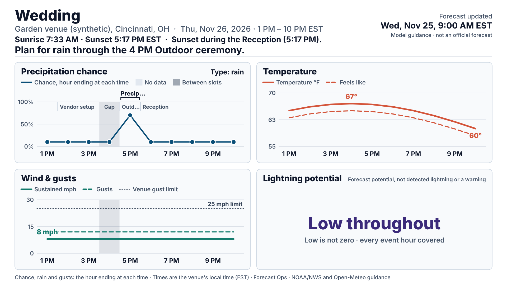

# Event Manager: planner-defined schedules (beta)

Events without gates (weddings, receptions, festivals) set their own time slots. New events start with one
editable **Event** window; planners add, rename and remove slots, each with its own date, start and end in the
venue's time zone. The stadium schedule (Setup, Gates, Event, Teardown from the venue's defaults) is an optional
template. Forecast calculations and thresholds are unchanged.

 

## Data model

```
event.slots = [{ id, name, start, end, main?, fold? }]   // venue-local "YYYY-MM-DDTHH:MM"; end may be the next day
event.times = { start, end }                             // the slots' outer start and end, kept beside them
```

* `Core.event.windows(ev)` returns one window per slot, in time order, labelled with the slot's name. The main slot
  takes the key `event` (everything that leads with the main part keeps working); other slots keep their own id.
  `all` spans the first start to the last end, and `all.spans` lists the hours the event actually uses (the union of
  its slots; one span for the fixed parts).
* An event **without** `slots` is read exactly as before (`times: {setup, gates, start, end, teardown}`). Nothing stored
  or shared is rewritten. In the editor such an event opens on the stadium template; if its parts are saved unchanged,
  it is saved as fixed parts again (`Core.event.legacyTimes`). A schedule that is exactly Setup / Gates / Event /
  Teardown back to back, or one window named Event, is always stored as fixed parts.
* Validation: every slot needs a name and a start and end, ends after it starts, no time skipped by a clock change,
  at most 24 slots and 7 days in all. Gaps are allowed. Overlapping slots and repeated names are warnings in the
  editor, not errors.

## Main slot

The slot that leads the headline ("Rain likely through the 4 PM Outdoor ceremony"):

1. the slot marked **Main slot** in the editor (the Wedding template marks the Outdoor ceremony);
2. otherwise the slot named "Event";
3. otherwise the longest slot that isn't setup, gates, doors, load-in or teardown work;
4. otherwise the first slot.

When a concern doesn't touch the main slot, the headline names the first slot it does touch ("Plan for rain during
the Reception, from 7 PM").

## Which slot an hourly value belongs to (interval rule)

Every hourly value has a time label, but not every value means the same moment. Planner-defined slots assign each value
by the interval it covers (`Core.event.KIND`, `Core.event.holding`); the fixed Setup / Gates / Event / Teardown parts keep
their existing path unchanged.

| Variable | Interval | Source |
| --- | --- | --- |
| Precipitation amount, snowfall | the hour **ending** at the label (rain labelled 4 PM fell 3–4 PM) | Open-Meteo hourly sums of the preceding hour; `Core.blend.aggregate` reads them as `acc` |
| Ensemble share with at least 0.01 in | the hour ending at the label | built from members' precipitation (`acc`) |
| Precipitation chance (PoP) | the hour ending at the label | Open-Meteo: "probability of precipitation … of the preceding hour" |
| Gusts | the hour ending at the label | Open-Meteo: "maximum of the preceding hour" |
| Temperature, feels-like, sustained wind and direction | **at** the label | instantaneous (`idx`) |
| Thunder tier | at the label | from CAPE and other instantaneous fields |

* A slot's own rating uses its hour-ending values from the hours that overlap it (as `Core.event.locate` already does
  for amounts; for slots, PoP and gusts are read over the same hours) and its instantaneous values from the labels
  inside it. Hazards follow their variable: rain, wind and snow by the hour ending at the label; lightning, heat and
  cold at the label.
* **Partial overlap:** an hour that only partly overlaps a slot is counted whole with that slot. Amounts are never
  split. The page says so: "Hourly data: 4–5 PM counted with the Outdoor ceremony; the forecast can't separate parts
  of an hour" (in "Why this is flagged", the hour's detail and the grid cell's title).
* **Between slots:** an hour-ending value whose hour meets no slot (rain falling 3–4 PM between Vendor setup and the
  ceremony, labelled 4 PM) stays in the hourly grid, the charts and the hourly image, shaded and labelled "Between
  slots" / "Gap", with its interval named ("Rain 3–4 PM", "the hour ending 4 PM"). It is left out of the slot totals,
  the concern and lead, At a glance and the hazard timeline.
* **Totals** are the same blend call (`C.blend.windowRow`) over the hours whose hour overlaps any slot, each hour once
  (the union), so overlapping slots never count an hour twice. A total is the sum of those hours' amounts. Per-hour
  values and thresholds are unchanged.
* "Why this is flagged" names the hours: "Totals cover your slots: 1–3 PM, 4–4:30 PM, 5–10 PM; rain that falls between
  them is not counted."

## Share links and backups

* Old links (`t: {setup, gates, start, end, teardown}`) open as before and produce the same link again.
* New links add `s: [[name, start, end, flags?], …]` (flags: `{m:1}` main slot, `{s:1}`/`{e:1}` second occurrence of
  a repeated fall-back time) and keep `t: {start, end}` as the outer window.
* A page from before slots ignores `s` and opens the link as one Event window over the same outer hours: the
  briefing then covers the gaps too and names no slots. Nothing fails.
* Workspace backups keep `slots` field by field (`cleanSlot`); a file from before slots restores unchanged.
* Calendar imports: an event at a known venue gets that venue's schedule as before; any other import is one Event
  window. An imported event the planner split into slots keeps its slots when the calendar moves it (each slot
  keeps its offset from the calendar start).

## Multi-day view (sketch, not built)



A weekend festival (Fri 5–11 PM, Sat 10 AM–11 PM, Sun 10 AM–6 PM) is three slots today. The briefing already skips
the overnight downtime (hazard timing and totals follow the operating windows) and says "Sunday pending" while the
guidance does not reach it. The follow-up would add:

* **Day picker**: one button per day with its hours and a one-line outlook ("No concern", "Rain 2–4 PM",
  "Missing guidance" when a later slot is beyond the models' reach).
* **Per-day briefing**: the lead, callouts, At a glance and hour by hour for the selected day's slots only.
* **Two-page printout for the selected day**: the same handout and hour table, titled with the day.
* **Official alerts** are still checked for the venue, for the whole event.

Built today, for reference: rain falling 3–4 PM between slots stays visible in the hourly chart, shaded and
labelled, and is left out of the totals and concerns; the hourly image shows the slot names.



