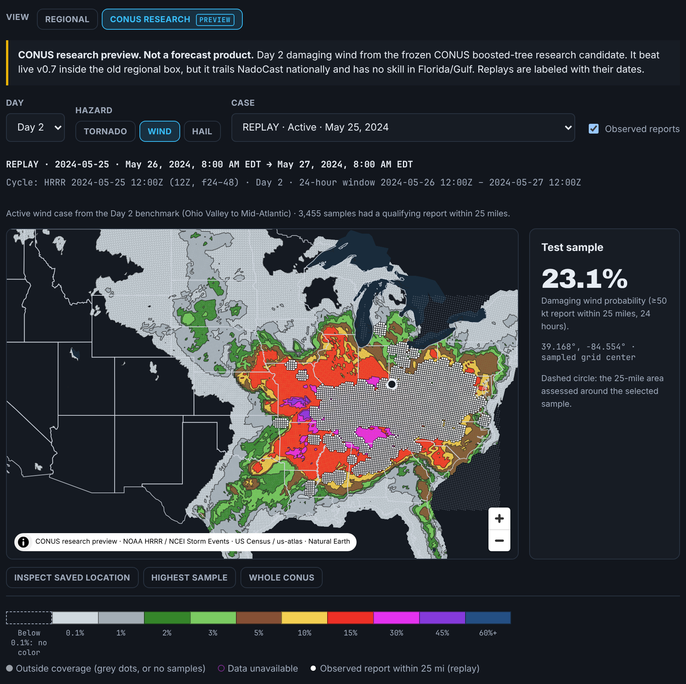
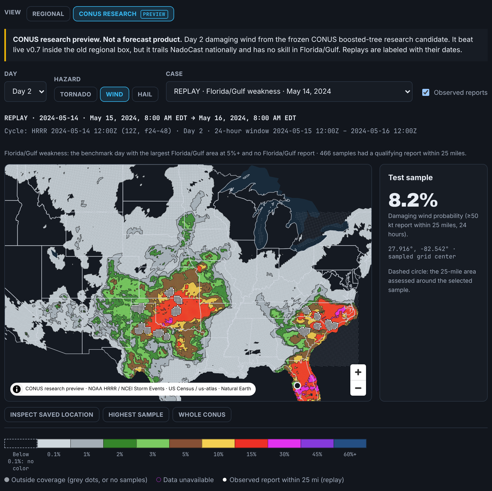
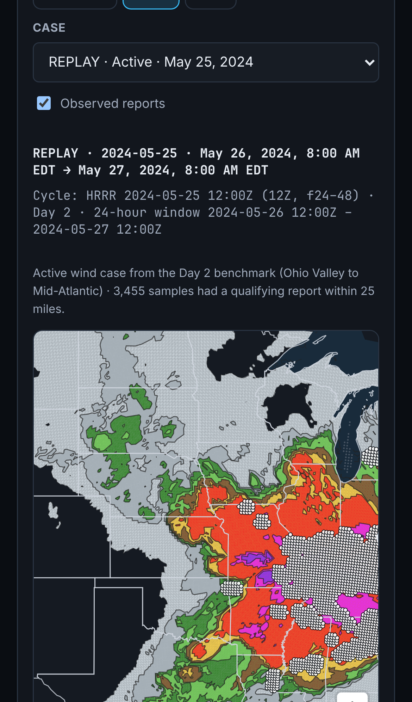
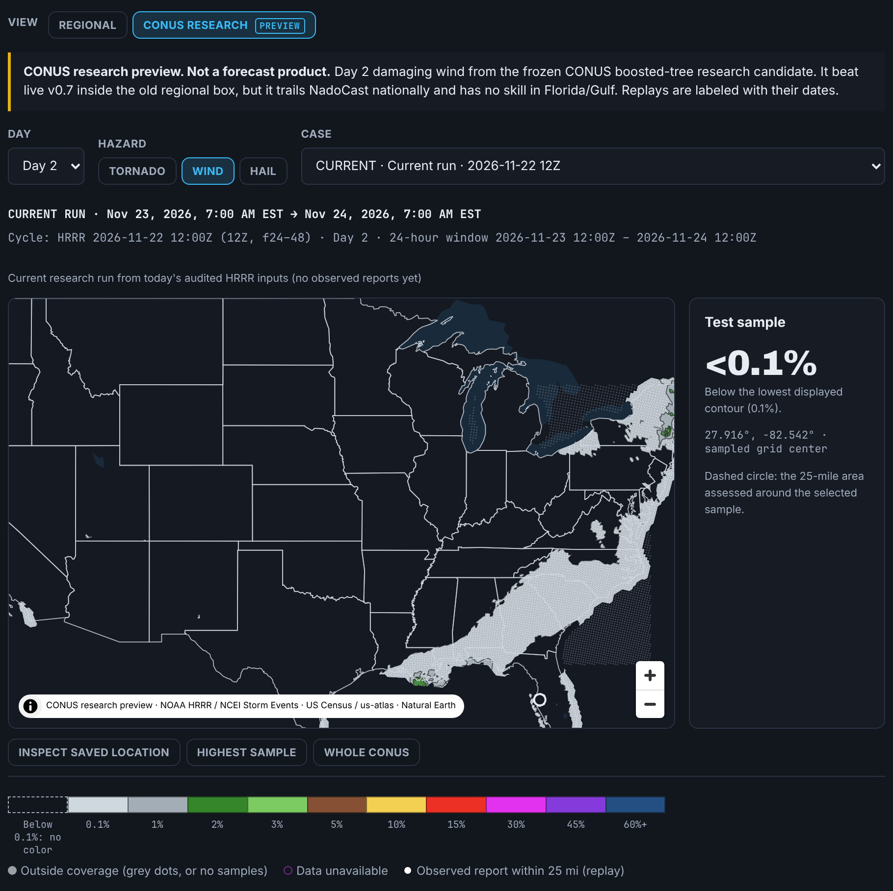
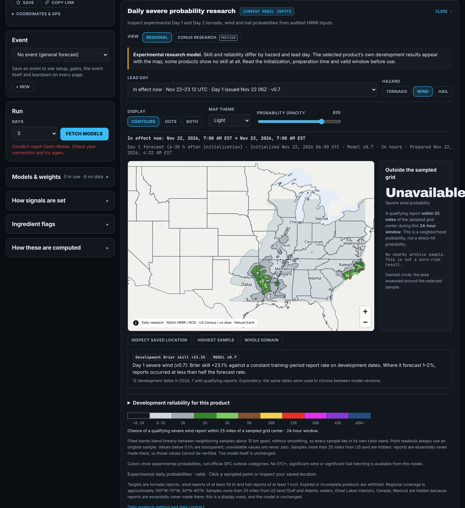

# CONUS Severe research preview (Day 2 damaging wind)

**Status: research preview. Not a forecast product and not eligible for operational use.**
The live Regional daily map (v0.7), its feed, the publisher, the model registry and the
RRFS/NBM collector are unchanged by this preview.

## What it is

The daily severe research panel on `severe.html` gains a **View** switch at the top:

- **Regional** (default): the existing live v0.7 map, unchanged.
- **CONUS research**: a separate viewer for the frozen CONUS boosted-tree research candidate,
  Day 2 damaging wind only.

The controls run in this order: View, then Day, then Hazard (with the case picker beside them).
Switching views carries the map center, zoom, selected sample, day and hazard both ways. If you
open `severe.html#severe-conus` directly, the viewer starts on Day 2 damaging wind.

Only **Day 2 damaging wind** has a national candidate. Every other day and hazard combination
covers the CONUS map with a visible "not available" panel offering **Show Day 2 wind** and
**Back to Regional**. No Day 1 tornado model appears in the CONUS view; the tornado work
(corridor v2 and the blend) stays a separate decision.

## Product

The value is the probability of a thunderstorm wind report of at least 50 kt within 25 miles of
the sampled grid center, during the 24-hour window from 12Z to 12Z.

- Day 2 is initialized from the 12Z HRRR, using forecast hours 24–48.
- The window runs from 12Z the day after initialization to 12Z the day after that.
- Reports are NCEI Storm Events Thunderstorm Wind reports of at least 50 kt. Reports with
  unknown magnitude are dropped, as in training.

## Model and grid

| Item | Value |
|---|---|
| Model | `research/severe/conus-v1/frozen/models.pkl`, sha256 `a9ff6aa7…8d7a`, product `day2_wind`, arm `conus_gbt` |
| Feature contract | `hrrr-daily-25mi-v2-future-window` (the audited HRRR daily predictors used in the CONUS study) |
| Grid | 40,311 samples (HRRR stride 5, about 15 km apart) |
| Supported samples | 38,838: within 25 miles of US land (the verified coverage mask) |
| Outside coverage | 1,473 samples, plus everywhere off the grid |

## Map states

The map distinguishes four states:

| State | Map | Readout |
|---|---|---|
| Value ≥ 0.1% | Filled contour bands, same scale as Regional | Percent |
| Below the lowest contour | Not colored | "<0.1%: Below the lowest displayed contour" |
| Outside coverage | A quiet neutral tint over mesh triangles touching an unsupported sample; nothing off the grid | "Outside coverage", explicitly not zero risk |
| Data unavailable | Hollow purple circles (a missing value at a supported sample) | "Data unavailable" |

Contours come from a triangle mesh with a maximum edge of 25 km, built over supported samples
only. Bands therefore stop at the coverage edge and do not bridge water or gaps.

Every feed file is checked against the sha256 recorded in `index.json`. A file that fails the
check, or fails to load, is refused. In that case the map shows no probability and the status
line explains why.

## Cases

Each case is labelled REPLAY or CURRENT with its issue date. The valid window and the forecast
cycle sit next to the legend.

| Label | Issue date (12Z) | Valid window | Why chosen (rule fixed in the builder) |
|---|---|---|---|
| Active | 2024-05-25 | 05-26 12Z – 05-27 12Z | The requested May 26, 2024 wind case; 3,455 report samples |
| Quiet | 2024-09-27 | 09-28 12Z – 09-29 12Z | Fresh May–Sep benchmark day with the fewest report samples (0) |
| Florida/Gulf weakness | 2024-05-14 | 05-15 12Z – 05-16 12Z | Day with the largest Florida/Gulf area at 5%+ and no Florida/Gulf report |
| Saved forecast | 2026-11-22 | 11-23 12Z – 11-24 12Z | Fresh audited HRRR extraction plus the frozen model; no labels |

- **Storm reports** (on by default) draws one marker per original qualifying record at its
  reported begin location, with the count beside the toggle. Markers cluster at national zoom and
  separate as you zoom in. Clicking one shows its time (ET and UTC, plus the source's local time),
  place, county and state, magnitude, and whether the gust was measured or estimated, with a link
  to the NCEI Storm Events record.
  - Source: the pinned `StormEvents_details-ftp_v1.0_d2024_c20260728.csv.gz` (SHA-256 checked),
    selected with the scoring code's own `labels.normalize` (Thunderstorm Wind, ≥50 kt, begin
    time inside the valid window).
  - The build refuses to write the file unless those records reproduce the replay's stored scored
    grid points and unknown points exactly. May 26: 776 reports → 3,455 grid points. Sep 28:
    0 → 0. May 15: 36 → 466.
  - An empty replay says "No qualifying reports in this window"; a missing or failed file says
    "Reports unavailable". The saved forecast has no reports.
- **Grid points within 25 miles of a report** (off by default) is the scored footprint: the
  white dots the first version labelled "Observed reports".
- **County lines** (on by default) fade in from about state zoom, using the CONUS us-atlas county
  file the Maps page uses. They sit above the probability fill and below the report markers.
- Replays reuse the archived CONUS extractions:
  - cohort run 44577990940;
  - benchmark run 44942885255, plus supplement 44961446546.
- The current run is extracted fresh by the same audited extractor. Its predictor and audit
  hashes are recorded in the case file.
- The current run is a one-off snapshot built by `severe-conus-preview.yml`. It is not
  scheduled, so it goes stale after its valid window ends.

## Checks performed

**Reproduction.** The builder recomputes the archived CONUS study's 12-date 2024 Day 2 wind
Brier for `conus_gbt` from the frozen model.

- Archived: 0.011891122250. Recomputed: 0.011891122250. Absolute difference: 0.0.
- Tolerance: 1e-9.
- Each published replay differs from the model's own output only by 6-dp rounding (≤ 5.0e-7;
  the tolerance is 1e-6).

**Spot checks in the viewer (Playwright against the tested commit), May 25 replay:**

- Kentucky, inside the old box: 22.9%.
- Detroit border: 3.4%.
- Orlando, Florida: 2.7%.
- Galveston coast: 0.3%.
- Maine coast: 0.1%.
- Denver (West) and El Paso border: below 0.1%.
- Offshore Atlantic, offshore Gulf, interior Mexico and interior Canada: Outside coverage.

**Interface:**

- All four unsupported day/hazard combinations show the unavailable panel, and both of its
  buttons work.
- A View round trip preserves center and zoom exactly.
- A tampered case file is refused with no probability shown.
- A missing value displays as "Data unavailable".
- There is no horizontal scroll at 390 px for either view.

## Benchmark context (213 fresh 2024 days, NadoCast score run 45046549803)

| Region | Candidate BSS | NadoCast BSS | Candidate − NadoCast Brier (95%) |
|---|---|---|---|
| CONUS | 0.101 | 0.204 | +0.0009 to +0.0016 (worse) |
| Original box | 0.126 | 0.235 | +0.0015 to +0.0032 (worse) |
| West | 0.021 | 0.062 | +0.0001 to +0.0003 (worse) |
| Plains outside box | 0.022 | 0.158 | +0.0011 to +0.0019 (worse) |
| Northeast outside box | 0.112 | 0.215 | −0.0001 to +0.0019 |
| Florida/Gulf/South | −0.093 | −0.056 | −0.0005 to +0.0007 |

Inside the old regional box the candidate beat live v0.7. The candidate's Brier minus v0.7's
was −0.00091, with a 95% interval of −0.00141 to −0.00047.

The candidate is still clearly behind NadoCast nationally, and it has negative skill in
Florida/Gulf.

## Not done / next before any national rollout

- Close the national gap to NadoCast. The Florida/Gulf weakness is negative skill, and the
  Plains outside the box show almost none.
- Build a scheduled, audited CONUS feed and publisher with freshness checks, matching the
  Regional path. Today's current run is a single manual snapshot.
- Sealed-year verification of the national candidate under the agreed protocol. 2021 stays
  sealed and 2025 stays sealed.

## Screenshots

