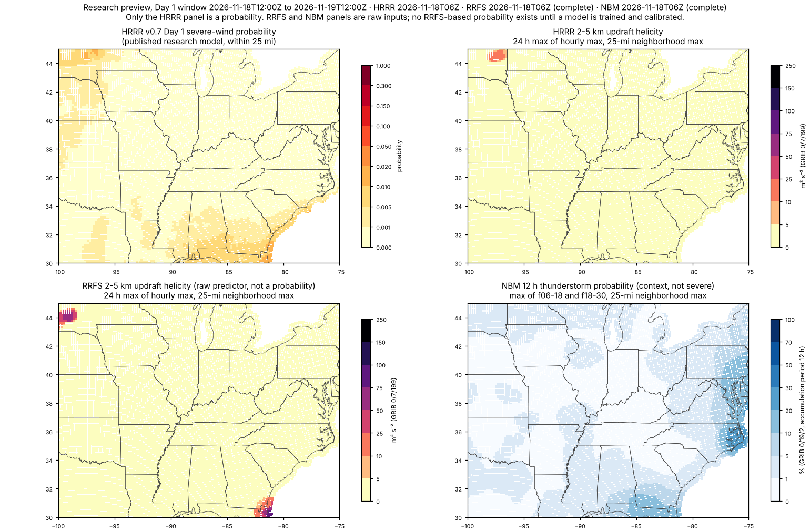

# Severe guidance upgrade, Phase 1: RRFS and NBM inputs (research)

**Status:** research inputs only. The production publisher, the v0.7 HRRR model (`a83218fb…e1e7e`),
the public feed and the protected 2025 outcomes are untouched. Nothing here is a forecast. The only
probability shown anywhere is the published v0.7 HRRR one.

Phase 1 delivers three things:
1. **Ingestion:** a bounded ingestion command, `tools/severe/guidance.py`, that puts operational
   RRFS and NBM onto the production 16,413-sample grid and into the frozen Day 1 / Day 2 windows.
2. **One real case:** compared sample-for-sample with HRRR v0.7, with a preview.
3. **Evidence for Phase 2:** an inventory of fields and availability, and a predefined
   matched-date comparison protocol.

## 1. Sources (verified 2026-11-19)

| Source | Location | Grid | Cycles that reach the windows |
|---|---|---|---|
| RRFS v1, operational | `s3://noaa-rrfs-ops-pds/rrfs.YYYYMMDD/HH/rrfs.tHHz.2dfld.3km.fFFF.conus.grib2` (+ `.idx`) | 3 km Lambert, **identical to the HRRR native grid**: 1799×1059, same projection and first point | 00/06/12/18Z run to f084. 03/09/15/21Z stop at f018, so they can't cover a 24 h window. |
| NBM, operational core | `s3://noaa-nbm-grib2-pds/blend.YYYYMMDD/HH/core/blend.tHHz.core.fFFF.co.grib2` (+ `.idx`) | NDFD 2.54 km Lambert, 2345×1597 (differs from HRRR) | Every hour. Hourly output to f036 on most cycles. |
| HRRR (production) | `s3://noaa-hrrr-bdp-pds` | 3 km Lambert | 06Z (Day 1), 12Z (Day 2), as today |

NOMADS (`nomads.ncep.noaa.gov`) was blocked by this session's network proxy and was not needed.
The AWS buckets above are NOAA's own open-data mirrors.

## 2. Field table

### RRFS against HRRR v0.7

These identities were decoded from the GRIB2 messages of the 2026-11-18 06Z cycle, not read from
the index names.

| v0.7 predictor | RRFS index record | GRIB identity (discipline/category/number, level) | Time | Units | Same as HRRR? |
|---|---|---|---|---|---|
| Surface CAPE | `CAPE:surface` | 0/7/6, surface | instant | J kg⁻¹ | **Yes** |
| Surface CIN | `CIN:surface` | 0/7/7, surface | instant | J kg⁻¹ | **Yes** |
| 0–1 km storm-relative helicity | `HLCY:1000-0 m above ground` | 0/7/8, heightAboveGroundLayer 1000 | instant | m² s⁻² | **Yes** |
| 2–5 km updraft helicity | `MXUPHL:5000-2000 m above ground` | 0/7/199, heightAboveGroundLayer 5000 | **max over previous hour** (start fH−1, end fH) | m² s⁻² (GRIB "unknown") | Identity yes. **Distribution no**, see below. |
| Composite reflectivity | `REFC:entire atmosphere (considered as a single layer)` | **0/16/5, atmosphereSingleLayer** (HRRR: 0/16/196, atmosphere) | instant | dBZ (GRIB "unknown"; HRRR "dB") | **No**: different code, and the clear-air floor is −20 dBZ in RRFS vs −10 in HRRR |
| 2 m dew point | `DPT:2 m above ground` | 0/0/6, heightAboveGround 2 | instant | K | **Yes** |
| 0–6 km shear, u and v | `VUCSH`/`VVCSH:0-6000 m above ground` | 0/2/15 and 0/2/16 | instant | labelled s⁻¹, values m s⁻¹ (same quirk as HRRR) | **Yes** |

RRFS also carries `GUST:surface`, `MAXUVV`, `MAXREF` (1 km, −10 °C), `MXUPHL` 0–3 km and
`LTNG`/`LTNGSD`. These were inventoried but are not used yet.

Two conclusions follow:
- **Updraft helicity** is the same hourly maximum, but RRFS magnitudes are far larger. On the case
  day, the 99th-percentile 25-mi neighborhood maximum was 26.8 m² s⁻² for RRFS vs 3.5 for HRRR, and
  the sample-level correlation was 0.47.
- **Reflectivity** is comparable in dBZ, but the background floor differs.

So RRFS predictors need their **own trained model**. They must not be swapped into the v0.7
coefficients. The ingestion command records this per field (`comparable: false` for UH and
reflectivity) and rejects any message whose decoded identity differs from the table above.

### NBM

| Field | Index record | GRIB identity | Valid interval | Units | Use |
|---|---|---|---|---|---|
| Thunderstorm probability | `TSTM:surface:A-B hour acc fcst:probability forecast` | 0/19/2, PDT 4.8 | 1, 3, 6 and **12 h** periods ending at each hour | % | Two 12 h periods tile each window exactly: Day 1 f06–18 + f18–30, Day 2 f24–36 + f36–48 |
| Wind gust | `GUST:10 m above ground:N hour fcst` (the separate `ens std dev` record is excluded by exact match) | 0/2/22, heightAboveGround 10 | instant, hourly | m s⁻¹ | 24 h max and mean of the 25-mi neighborhood max |

**Mapping:** NBM is on a different grid, so each sample takes the maximum over NBM cells within
40.2336 km (great-circle) of its center, plus the nearest cell. That is 788 / 826 / 905 cells per
sample (minimum / median / maximum).

**Overlap with RRFS:** NBM v5.x already blends RRFS/REFS
([NOAA VLab, NBM](https://vlab.noaa.gov/web/mdl/nbm)). Its value must therefore be measured
*after* RRFS is in the model, as in the protocol below.

## 3. Availability: observed, not assumed

The timing survey uses the later S3 `LastModified` value of each GRIB and its required index.
This describes the objects present when we listed the archive. It does not establish the first
time either object could be downloaded. The collector records listing-observation times and
successful fetch timestamps separately, with ETags linking the fetched bytes to the listed objects.
A backfill performed after the forecast deadline cannot establish issue-time fetch availability.

The deadlines are those of the production schedule:

| Lead | Deadline the candidate must beat | Window start |
|---|---|---|
| Day 1 | 09:30Z, the scheduled run | 12:00Z the same day |
| Day 2 | 15:30Z, the scheduled run | 12:00Z the next day |

Observed on 2026-11-17 and 2026-11-18 (`research/severe/guidance-phase1/cycle-arrival-20261117-18.json`):

| Lead | Cycle | Latest GRIB/index timestamp | Margin before the scheduled run |
|---|---|---|---|
| Day 1 | **RRFS 06Z** f006–f030 | 07:51:09–07:51:17Z | about 1 h 39 m |
| Day 1 | RRFS 00Z (f012–f036, older) | 02:31:25–02:36:32Z | about 7 h |
| Day 1 | **NBM 06Z** core | 06:45:02–06:47:00Z | at least 2 h 43 m |
| Day 1 | NBM 07Z (hourly to f264) | 08:34:49–08:34:58Z | about 55 m |
| Day 1 | NBM 09Z | 09:44:52–09:47:30Z | misses 09:30Z, but beats the 12Z window start |
| Day 2 | **RRFS 12Z** f024–f048 | 14:45:02–14:45:55Z | about 45 m (tight) |
| Day 2 | RRFS 06Z (f030–f054, older) | 08:16:20–08:18:40Z | about 7 h |
| Day 2 | **NBM 12Z** core | 13:06:11–13:06:39Z | about 2 h 24 m |

For both leads, every needed GRIB/index pair at the default cycles had timestamps before the deadline on both days. The Day 2 RRFS 12Z margin
is about 45 minutes, so Phase 3 must measure how often it is missed. The command accepts an older
RRFS cycle (`--rrfs-cycle 6` for Day 2) as a fallback, but a fallback is a different input and must
be scored as its own configuration.

## 4. The real case: 2026-11-18, Day 1 (06Z)

This was a quiet November day: the published v0.7 maximum severe-wind probability was 1.9%.

```bash
python tools/severe/guidance.py --date 2026-11-18 --day 1 --sources rrfs nbm \
    --output tests/out/guidance-20261118-day1 --cache tests/out/guidance-cache
python tools/severe/product.py --date 2026-11-18 --day 1 --model research/severe/baseline-v07/models.json \
    --model-sha256 a83218fb409683f2dd8b1a92c335c379010a2f7299b7a8705fb36960e9ae1e7e \
    --output tests/out/hrrr-20261118-day1 --cache tests/out/hrrr-cache
python tools/severe/guidance_preview.py --guidance tests/out/guidance-20261118-day1 \
    --hrrr tests/out/hrrr-20261118-day1 --output docs/images/severe-guidance-20261118-day1.png
```

**Ingestion results:**
- RRFS: 25/25 hours on time; 192 messages, the same count the HRRR raw audit checks.
- NBM: 25/25 hours on time; 26 messages.
- 216.6 MB downloaded in about 1 minute.
- RRFS sample coordinates equal the production grid exactly (maximum difference 0.0°).

**Reproduced from saved files:** a second run from the cache downloaded 0 bytes and produced
byte-identical message and feature checksums. Every message's index line, byte range and SHA-256 is
in `research/severe/guidance-phase1/availability-20261118.json`.

**HRRR on the same samples:** `product.py` reproduces the published probabilities exactly (maximum
difference 0.0). RRFS produces the **same 34 feature columns** as v0.7.

**Day 2:** the same date, from the 12Z cycles, was also complete and on time for both sources.



The preview's panels:
- **Top left:** published v0.7 HRRR severe-wind probability, the only probability on the page.
- **Top right:** HRRR 2–5 km UH.
- **Bottom left:** RRFS 2–5 km UH, a raw predictor.
- **Bottom right:** NBM 12 h thunder probability, as context.

All panels use the production display mask. On this day RRFS has UH cores in far northeastern
South Dakota and along the Georgia / northeast Florida coast, where HRRR's are much weaker.

Same-sample comparison, 24 h maximum of the 25-mi neighborhood maximum:

| Feature | HRRR p99 | RRFS p99 | Pearson r |
|---|---|---|---|
| 2 m dew point (K) | 292.8 | 293.7 | 0.95 |
| 0–6 km shear u (m s⁻¹) | 40.0 | 38.9 | 0.97 |
| 0–1 km SRH (m² s⁻²) | 436.7 | 364.0 | 0.96 |
| Surface CAPE (J kg⁻¹) | 950 | 1044 | 0.92 |
| Composite reflectivity (dBZ) | 49.2 | 51.3 | 0.83 |
| 2–5 km UH (m² s⁻²) | 3.5 | 26.8 | **0.47** |

The environment fields agree closely. The storm-scale field, UH, is where RRFS offers a genuinely
different view, which is why it is worth testing. It is also why it cannot borrow HRRR's
calibration.

## 5. What history can be retrieved

| Archive | Coverage | Version notes | Usable for training? |
|---|---|---|---|
| RRFS ops bucket `noaa-rrfs-ops-pds` | `rrfs.20260812` → present, 99 consecutive days as listed on 2026-11-19 | Reports differ on the operational start (about 2026-11-03); see the [AWS registry entry](https://registry.opendata.aws/noaa-rrfs/) and [Herbie's RRFS notes](https://herbie.readthedocs.io/en/stable/gallery/noaa_models/rrfs.html). Days before the start may be the pre-implementation parallel. | Only once each day's version is pinned. Treat 2026-11-03 onward as v1 until shown otherwise. |
| RRFS retrospective `noaa-rrfs-pds/retro_output_final/` | Summer 2023-07-01→31, winter 2024-01-08→02-08, spring 2024-05-01→31 (about 94 days) | Pre-operational "final retrospective parallel". `prslev` files, same 3 km grid (decoded), and all eight fields indexed | **Research only.** It overlaps the cohort's 2023-07-01/08/15/22 training dates and the 2024 development months. It is not operational v1, so results must not be presented as v1 skill. |
| RRFS real-time prototype `noaa-rrfs-pds` (`rrfs_a/`) | Empty now | Pre-implementation, not monitored 24×7 | No |
| NBM `noaa-nbm-grib2-pds` | `blend.20200518` → present | Several NBM versions across the archive. RRFS/REFS enter with v5.x. | Only within a single version. Record the version per date. |
| HRRR `noaa-hrrr-bdp-pds` | 2014 → present | As used by v0.7 | Yes (already) |

Three practical consequences:
1. **No version-matched history exists:** there is no historical period where operational RRFS v1,
   the current NBM and HRRR all overlap with our 2022–2024 training cohort.
2. **Retrospective use is limited:** the retrospective runs can de-risk feature engineering, but a
   real comparison needs prospective data.
3. **2025 stays untouched:** 2025 dates remain sealed, and the command refuses them.

## 6. What to start capturing now (prospective)

The separate **Severe research guidance collection** workflow accepts an explicit date and
collects both leads on independent runners. It checks the HRRR predictor contract and audits
the raw HRRR messages, then captures RRFS and NBM on the same grid. It uploads a collection
manifest for each attempted window, including source failures, with verified feature files
for the sources that completed. Each successful fetch records its time and checksum. The
workflow is read-only and keeps its test artifacts for 30 days. It has no daily schedule.

Before enabling daily collection, choose a durable private destination and retention for the
paired features, manifests and failure records. The measured RRFS/NBM transfer alone is about
216 MB per lead, or 13 GB per 30 days for both leads, before HRRR. The manual workflow discards
the download cache after producing the feature artifacts. Size the durable archive using those
compressed feature artifacts. If raw GRIB retention is needed, plan it separately using
measured volumes and retain both raw blobs and their receipts. Future scheduled capture should
observe inputs at issuance deadlines to distinguish timely access from retrospective availability.

## 7. Proposed matched-date comparison (Phase 2), fixed before any scoring

**Configurations** (each trained and calibrated on its own inputs, with the same method as v0.7):
- A: HRRR only
- B: RRFS only
- C: HRRR + RRFS
- D: HRRR + RRFS + NBM

**Targets:**
- Same targets as v0.7: any tornado, wind ≥ 50 kt or hail ≥ 1 in. within 25 statute miles
  (40.2336 km), 12Z–12Z.
- Same NCEI Storm Events labelling rules and hash-pinned sources.

**Leads and windows:** the existing Day 1 (06Z, f06–f30) and Day 2 (12Z, f24–f48) windows. Inputs
must arrive before the same deadlines as production.

**Hazard order:** start with Day 1 severe wind. Carry only the approach that wins on Day 1 wind into
tornado, hail and Day 2.

**Eligible dates:** a date counts for a configuration only if every input that configuration needs
was complete and on time by the scheduled run. The **primary comparison uses only the dates eligible
for all four configurations**, so every model is scored on the same days.

**Coverage, reported separately for each configuration:**
- the share of scheduled dates it could have published;
- the share of dates with reports that it could have published;
- an "operational" score in which a missing candidate falls back to the published HRRR v0.7 forecast.

A configuration therefore cannot look better by skipping hard or late days.

**Scoring:**
- Brier score per hazard and lead.
- Brier skill against:
  1. the constant training-period rate;
  2. the long-record (pre-2022) report climatology;
  3. configuration A on the same dates.
- Reliability tables on fixed probability bins, with the same rule-based over/underforecast flags as
  the current registry.
- Log loss as a secondary measure.

**Uncertainty:**
- Paired differences against A, resampled by whole dates (block bootstrap), 90% intervals.
- Results broken out by hazard and lead.

**Decision rule (proposed):**
- A configuration replaces A for a hazard and lead only if its paired Brier difference against A
  is < 0 with the 90% interval excluding zero, and its reliability is no worse.
- Adding NBM (D vs C) must clear the same bar against C.

**Minimum evidence before any decision (proposed):**
- at least 60 all-four-eligible dates per lead;
- including at least 20 with reports of that hazard inside the domain.

Quiet-season days alone will not support a decision.

**Splits:**
- Dates are assigned to training and evaluation by whole date, and frozen before any outcome is
  looked at.
- 2025 is never used.

## 8. Files

- `tools/severe/guidance.py`: ingestion. It reuses the production client, decoder, time checks,
  25-mi disk maximum and 24 h aggregation.
- `tools/severe/guidance_preview.py`: the local preview.
- `tests/severe-guidance.test.py`: offline tests (9).
- `research/severe/guidance-phase1/availability-20261118.json`: the real case record (per-hour
  arrival and status, message ranges and checksums, feature hashes, RRFS-vs-HRRR comparison).
- `research/severe/guidance-phase1/cycle-arrival-20261117-18.json`: the multi-cycle arrival survey.
- `docs/images/severe-guidance-20261118-day1.png`: the preview, with summary values in the
  matching `.json`.
