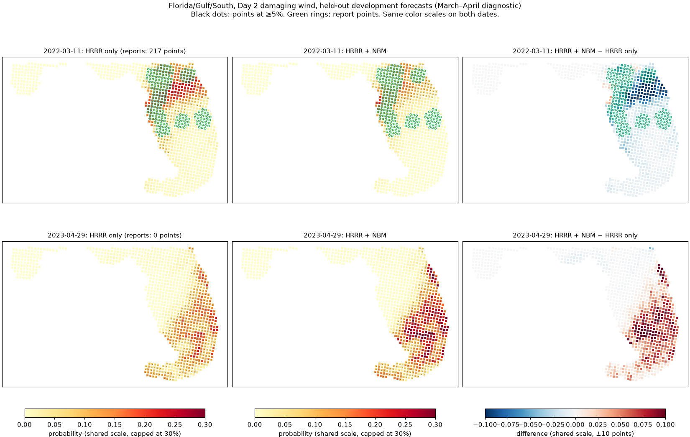

# March–April Florida/Gulf diagnostic: HRRR + NBM vs HRRR only (Day 2 wind)

Development data only; the failed verdict stands. Both folds reproduced the original per-date, per-region totals (see reproduction-fold-*.json) before any of this was computed.

- Florida/Gulf net loss over all 726 dates (sum of squared-error change): 54.448 (Brier +0.000076 per point, as in gate.md).
- March–April (122 held-out dates, 121,024 Florida/Gulf points): change 41.479, **76% of the net 726-date loss**.

| Point class | Points | Brier change (sum) | Share of Mar–Apr change | Share of 726-date net loss | mean p HRRR | mean p HRRR+NBM |
|---|---|---|---|---|---|---|
| no-report, both below 5% | 104,045 | -3.848 | -9% | -7% | 0.0063 | 0.0047 |
| no-report, NBM pushed above 5% | 1,202 | +2.532 | +6% | +5% | 0.0415 | 0.0614 |
| no-report, NBM dropped below 5% | 2,448 | -8.945 | -22% | -16% | 0.0684 | 0.0366 |
| no-report, both at or above 5% | 12,040 | +50.116 | +121% | +92% | 0.1291 | 0.1385 |
| report points, NBM lower | 678 | +31.076 | +75% | +57% | 0.1261 | 0.0988 |
| report points, NBM higher or equal | 611 | -29.453 | -71% | -54% | 0.1333 | 0.164 |

Positive = NBM worse. Shares can exceed ±100% because classes offset each other.

## Largest March–April dates

| Date | Report pts | Change | No-report part | Report part | Share of net loss | pts ≥5% HRRR → NBM | report pts ≥5% HRRR → NBM |
|---|---|---|---|---|---|---|---|
| 2023-04-28 | 49 | +7.933 | +9.654 | -1.721 | +15% | 767 → 793 | 49 → 49 |
| 2023-04-29 | 0 | +7.923 | +7.923 | +0.000 | +15% | 426 → 471 | 0 → 0 |
| 2022-03-11 | 217 | +7.820 | -2.460 | +10.280 | +14% | 343 → 261 | 155 → 134 |
| 2023-04-15 | 67 | +6.120 | +7.542 | -1.422 | +11% | 464 → 510 | 60 → 54 |
| 2023-04-27 | 0 | +5.083 | +5.083 | +0.000 | +9% | 614 → 580 | 0 → 0 |
| 2022-04-01 | 109 | +2.820 | +1.419 | +1.401 | +5% | 731 → 587 | 86 → 88 |
| 2022-03-17 | 5 | +2.359 | +2.552 | -0.194 | +4% | 310 → 201 | 5 → 5 |
| 2023-04-14 | 63 | +2.138 | -2.112 | +4.250 | +4% | 416 → 290 | 63 → 55 |
| 2022-03-15 | 24 | +2.093 | +3.511 | -1.419 | +4% | 463 → 479 | 24 → 24 |
| 2022-03-09 | 0 | +1.816 | +1.816 | +0.000 | +3% | 518 → 520 | 0 → 0 |

## Input associations (clues only, not attribution)

| NBM input | corr with NBM−HRRR change at no-report points | mean where NBM raised | mean where NBM lowered |
|---|---|---|---|
| nbm_gust10m_nearby_max_max | +0.10 | 13.3 | 12.6 |
| nbm_gust10m_nearby_max_mean | +0.08 | 10.9 | 10.4 |
| nbm_tstm_24_36_nearby_max | +0.26 | 39.5 | 12.9 |
| nbm_tstm_36_48_nearby_max | +0.10 | 24.5 | 10.0 |
| nbm_tstm_24_36_nearest | +0.01 | 14.4 | 5.8 |
| nbm_tstm_36_48_nearest | -0.06 | 8.8 | 4.4 |
| nbm_tstm12_nearby_max_max | +0.25 | 41.9 | 14.3 |

